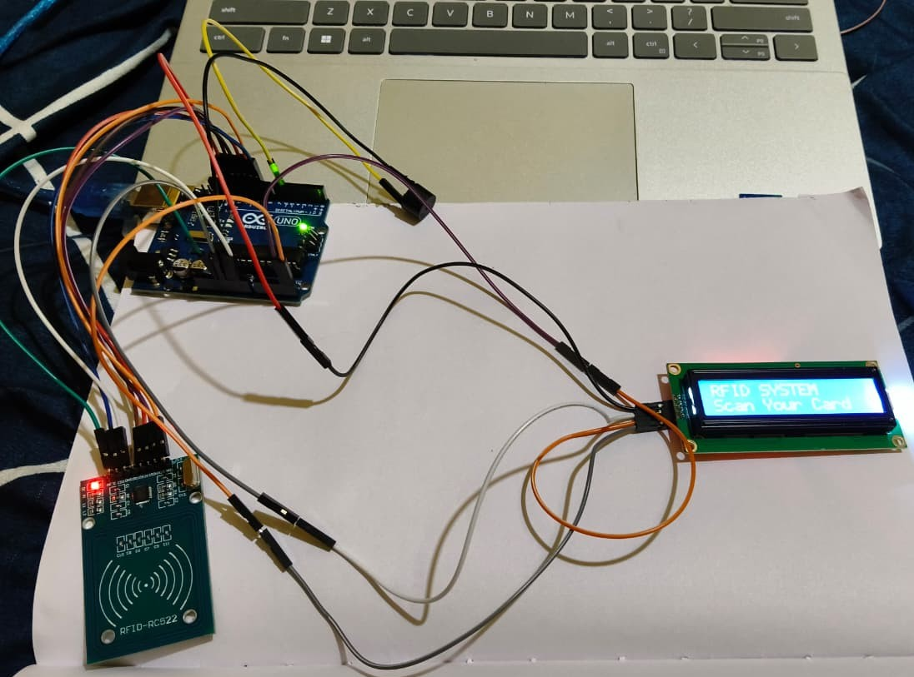
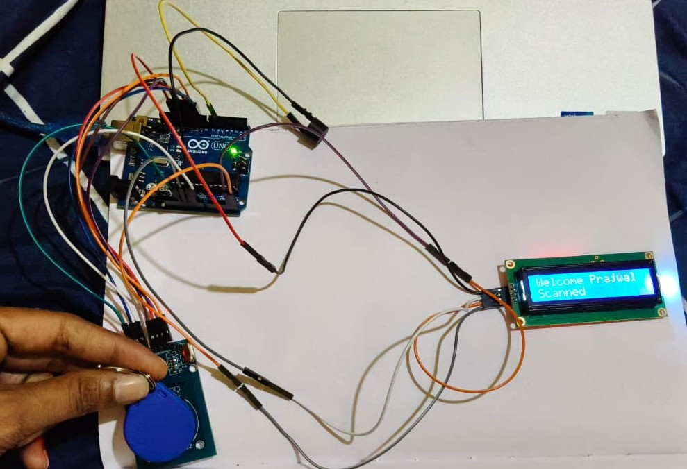
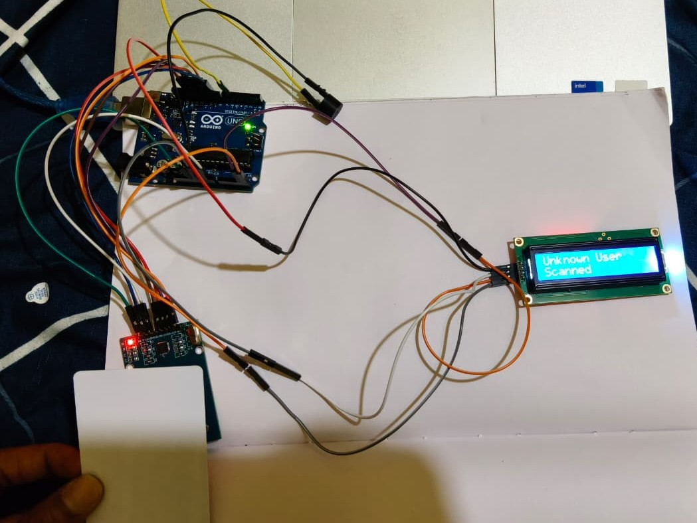

# RFID-Based Access Control System

## About the Project

This project is an RFID-based access control system developed using an Arduino Uno and an RC522 (MFRC522) RFID reader. It scans RFID cards, checks whether the card is authorized, and displays the result on an I2C LCD.

The system also uses a buzzer to provide audio feedback for successful and unsuccessful scans. I developed this project to gain practical experience with Arduino programming, RFID technology, LCD interfacing, and embedded systems.

## Features

- Reads RFID card identifiers using the RC522 module.
- Checks scanned card UIDs against an authorized UID stored in the program.
- Displays access status on a 16x2 I2C LCD.
- Produces a long beep for an authorized card.
- Produces three short beeps for an unauthorized card.
- Prints scanned card UIDs and access results to the Serial Monitor.
- Returns to the home screen after displaying the scan result.

## Hardware Components

- Arduino Uno
- RC522 (MFRC522) RFID reader module
- Compatible RFID card or tag
- 16x2 LCD with I2C interface
- Buzzer
- Breadboard and jumper wires
- USB cable and suitable power connections

## Software and Libraries

- Arduino IDE
- SPI library
- MFRC522 library
- Wire library
- hd44780 LCD library

The SPI and Wire libraries are included with the standard Arduino environment for supported boards. Install the MFRC522 and hd44780 libraries through the Arduino IDE Library Manager if needed.

## How It Works

1. The system initializes the RFID reader, LCD, and buzzer.
2. The LCD displays the home screen and prompts the user to scan a card.
3. When a compatible RFID card is detected, the Arduino reads its UID.
4. The program compares the scanned UID with the authorized UID stored in the code.
5. If the UID matches, the LCD displays a welcome message and the buzzer produces one long beep.
6. If the UID does not match, the LCD displays an unknown-user message and the buzzer produces three short beeps.
7. The scanned UID and access result are printed to the Serial Monitor.
8. After three seconds, the LCD returns to the home screen.

## Circuit Connections

The following are the pin assignments used in the supplied Arduino code, together with typical RC522 SPI connections.

### RC522 to Arduino Uno

| RC522 Pin | Arduino Uno Pin |
|---|---|
| SDA / SS | D10 |
| SCK | D13 |
| MOSI | D11 |
| MISO | D12 |
| RST | D9 |
| GND | GND |
| 3.3V | 3.3V |
| IRQ | Not connected |

### Buzzer

| Buzzer Connection | Arduino Uno Pin |
|---|---|
| Signal | D6 |
| GND | GND |

### I2C LCD

| LCD Connection | Arduino Uno Pin |
|---|---|
| SDA | A4 |
| SCL | A5 |
| VCC | According to the LCD module's requirements |
| GND | GND |

Verify all connections against your actual hardware. The RC522 is a 3.3V device; do not power it from the Arduino Uno's 5V pin. Check signal-voltage compatibility as well.

## How to Run the Project

1. Install the Arduino IDE.
2. Install the MFRC522 and hd44780 libraries using Library Manager.
3. Connect the RC522, I2C LCD, and buzzer to the Arduino Uno.
4. Open `rfid_access_control.ino` in the Arduino IDE.
5. Configure the authorized card UID in the source code.
6. Select Arduino Uno and the correct serial port.
7. Upload the program to the board.
8. Open the Serial Monitor at 9600 baud.
9. Scan an authorized card and an unauthorized card to observe the system's response.

## Project Images

Photos of the actual circuit and hardware can be added here.

## Project Images

### Hardware Setup

### Access Granted

### Access Denied

### Serial Monitor Results

**Access Granted**

**Access Denied**

Update the image paths to match the filenames in your repository.

## Skills Demonstrated

- Arduino programming in C/C++
- Embedded systems development
- RFID card identification
- SPI communication
- I2C communication
- LCD and buzzer interfacing
- Basic access control logic
- Hardware and software integration

## Future Improvements

- Add a relay and suitable driver circuit to control an electronic lock.
- Store authorized credentials more securely.
- Add access logs with timestamps.
- Improve credential management and administrative controls.

## Author

**[Prajwal V]**

Electronics and Communication Engineering (ECE)
